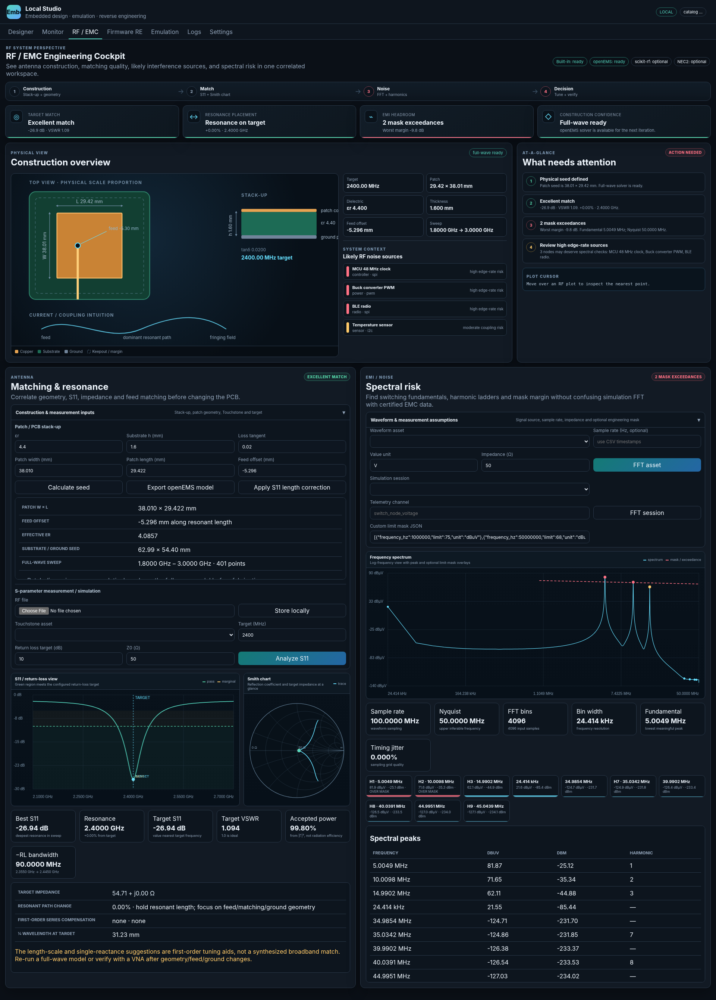

# RF / EMC simulation perspective

Embeddyn includes a local RF / EMC engineering perspective for antenna tuning, microwave-network inspection and RF-noise pre-compliance analysis. It is intentionally split into a **built-in analysis layer** and **optional full-wave/network solver integrations** so ordinary Studio use does not require a large EM solver installation.

## What the perspective covers

### Antenna and RF-network tuning

Input:

- Touchstone `.s1p`, `.s2p`, ... data from a VNA, openEMS or another EM/network solver;
- target frequency and reference impedance.

Built-in/design output:

- rectangular microstrip patch starting dimensions from target frequency, dielectric constant and substrate thickness;
- a generated, validated openEMS Python model that exports `patch.s1p`, `summary.json` and principal-plane `farfield.csv`;
- S11 in dB;
- return loss;
- VSWR;
- accepted-power percentage;
- complex input impedance derived from the reflection coefficient;
- detected resonance minima;
- threshold bandwidth, by default the `S11 <= -10 dB` region;
- target-frequency impedance and matching state;
- first-order resonant-current-path length correction;
- first-order single series-reactance cancellation suggestion.

The geometry scale uses the usual first-order inverse relationship between electrical length and resonant frequency. It is a tuning hint, not a replacement for another EM solve. Feed position, ground geometry, enclosure, nearby copper, substrate dispersion/loss and matching components all disturb that idealized scaling.

### Generated RF-noise / EMI spectrum

Input:

- CSV/TSV time-domain waveform with timestamps or an explicit sample rate; or
- any numeric channel already stored in an Embeddyn simulation/emulation session.

Built-in output:

- Hann-windowed FFT;
- frequency-bin width and Nyquist limit;
- peak and RMS amplitude;
- dBV RMS and dBuV RMS;
- dBm when a measurement impedance is supplied (50 ohm default);
- dominant spectral peaks and probable harmonic numbers;
- sample-timing jitter estimate;
- optional custom engineering limit-mask overlay.

The built-in spectrum is deliberately labelled **pre-compliance**. A numerical FFT of a node voltage/current is not automatically a CISPR/FCC radiated or conducted measurement. A compliance result additionally depends on the specified LISN/probe/antenna, detector, resolution/video bandwidth, dwell time, calibration, cable/fixture, ground plane, chamber/OATS setup and distance.

## Local Studio workflow

Start Local Studio and open **RF / EMC**.

```bash
embeddyn studio run
```

### Visual engineering cockpit

The RF perspective is intentionally organized for fast visual diagnosis rather than forcing the engineer to correlate unrelated tables. The top of the workspace now provides:

- a four-step **Construction → Match → Noise → Decision** workflow strip;
- status cards for target match, resonance placement, EMI headroom and construction confidence;
- a scale-proportional top view of the rectangular patch plus an RF stack-up cross-section, feed location, keepout/margin and resonant-current-path cue;
- a heuristic system-context list that highlights loaded project nodes likely to deserve RF attention, such as clocks, PWM/switching power, motors and fast digital buses;
- an **at-a-glance action panel** that turns measurements into concrete next steps;
- a shared plot cursor that reports frequency, S11/VSWR/impedance or spectral level under the pointer.

The antenna area combines a return-loss view with target/pass overlays and a Smith chart, so resonance placement and impedance movement can be judged together. The EMI area uses a log-frequency spectrum with harmonic markers, custom-mask overlays, exceedance markers and a compact peak ladder. Colors carry consistent meaning: green = target met, amber = review/tune, red = action needed.

If stack-up, target, matching assumptions or the EMI mask are edited after analysis, the relevant cards change to a **stale / re-run required** state instead of presenting the previous result as current. The project-node RF source ranking is explicitly heuristic; it is a guide for selecting signals to analyze, not a field-solver or compliance result.



The detailed antenna and noise controls remain collapsible underneath the visual overview, keeping the common interpretation path dense while preserving full engineering inputs.

### Antenna workflow

1. Enter the target frequency plus the actual RF-frequency substrate `epsilon_r`, thickness and loss tangent.
2. Press **Calculate seed** to obtain a rectangular microstrip patch starting width/length/feed position.
3. Press **Export openEMS model** to download a trusted generated full-wave Python model, or use the equivalent CLI command.
4. Run the model in an openEMS Python environment; it produces `patch.s1p`, `summary.json` and, when NF2FF succeeds, `farfield.csv`.
5. Store the resulting `.s1p` locally in Studio and press **Analyze S11**.
6. Inspect resonance, target VSWR/impedance, accepted power and return-loss bandwidth.
7. Press **Apply S11 length correction** to scale the patch resonant length from the observed resonance toward the target.
8. Export/re-run the updated model and iterate. Tune the feed/matching network after the resonance is placed correctly.
9. Validate the final PCB/enclosure with a VNA and pre-compliance measurement.

### RF-noise workflow from SPICE or co-simulation

1. Export the switching node, supply current, cable/common-mode proxy or other waveform to CSV, or keep it in Embeddyn session telemetry.
2. Ensure the sample rate is high enough for the RF band of interest. The highest representable frequency is `sample_rate / 2`.
3. Select the waveform asset, or select a session and enter the telemetry channel.
4. Enter the impedance represented by the waveform (50 ohm only when that is physically meaningful).
5. Press **FFT asset** or **FFT session**.
6. Inspect switching harmonics and the warning list.
7. Increase the transient simulation sample rate and duration when either RF span or frequency resolution is insufficient.

A custom mask can be supplied as JSON:

```json
[
  {"frequency_hz": 150000, "limit": 66, "unit": "dBuV"},
  {"frequency_hz": 500000, "limit": 56, "unit": "dBuV"},
  {"frequency_hz": 30000000, "limit": 56, "unit": "dBuV"}
]
```

Embeddyn interpolates the mask on a log-frequency axis. This is an engineering overlay only; it does not add regulatory detector/RBW/VBW semantics.

## Command line

### Backend status

```bash
embeddyn rf status
```

This reports the built-in engine and optional `openEMS`, `AppCSXCAD`, `scikit-rf` and `nec2c` installations.

### Patch seed and openEMS model generation

```bash
embeddyn rf patch-seed --target-hz 2.45e9 --epsilon-r 4.4 --substrate-mm 1.6
embeddyn rf patch-openems-script patch_2450.py \
  --target-hz 2.45e9 --epsilon-r 4.4 --substrate-mm 1.6 --loss-tangent 0.02
python patch_2450.py
```

The generated script is structured code produced only from validated numeric RF parameters. It creates the patch/substrate/ground/feed geometry, runs openEMS, exports a Touchstone S1P sweep, records input impedance at the best match and attempts two principal far-field cuts. It does not accept user script fragments.

### Touchstone antenna analysis

```bash
embeddyn rf touchstone antenna.s1p --target-hz 2.45e9 --return-loss-db 10 -o rf-report.json
```

### RF-noise FFT

With timestamped CSV:

```bash
embeddyn rf noise switching-node.csv --impedance-ohms 50 -o noise-report.json
```

With a value-only CSV:

```bash
embeddyn rf noise switching-node.csv --sample-rate-hz 2e9 --impedance-ohms 50
```

### Native openEMS XML execution

Embeddyn deliberately runs only a pre-generated XML model through the native solver. It does not execute uploaded Python/Octave scripts from the web API.

```bash
embeddyn rf openems-run model.xml
```

For custom geometries Embeddyn still accepts trusted pre-generated XML through this low-level runner. For the built-in rectangular patch workflow, prefer `patch-openems-script`: it generates the geometry and post-processing code itself and feeds its S1P result back into the RF / EMC perspective.

## Solver/tool integration

### openEMS

openEMS is the recommended open-source full-wave backend for PCB antennas, near fields and far fields. It is an EC-FDTD solver with Python/Octave interfaces, near-field to far-field processing and field dumps.

The west-like manifest contains `openems-project` as a recursive source dependency pinned to stable `v0.0.36`. The repository lock freezes that release at `d0d2e8dad8a02388f1919bbcdd29a67e9199dd2c`. The `rf` and `full` bootstrap profiles select it.

```bash
python bootstrap.py sync --profile rf
python bootstrap.py status --profile rf
```

After syncing, Embeddyn can invoke the pinned upstream build driver locally:

```bash
embeddyn rf openems-build --no-gui
```

The default install prefix is `.embeddyn/tools/openems`. Source/editable installs discover its `bin/openEMS` automatically; a system installation on `PATH` and the standard `OPENEMS_INSTALL_PATH`/`EMBEDDYN_OPENEMS_PREFIX` environment variables are also supported. Native compiler/library prerequisites remain platform-specific and follow upstream openEMS installation requirements.

### scikit-rf

The optional `rf` Python extra installs scikit-rf for richer Touchstone/N-port/network operations. The built-in parser remains available without it, which keeps Studio functional during bootstrap and in minimal/offline environments.

```bash
python bootstrap.py bootstrap --profile rf
```

### NEC2

If a `nec2c` executable is on `PATH`, `embeddyn rf status` reports it as available. It is suitable for many wire-antenna problems, while openEMS is the preferred path for PCB/enclosure/near-field work.

## Recommended end-to-end RF design loop

1. **Electrical/SPICE transient** – characterize edge rates, switch-node ringing, supply/current impulses and clock spectra.
2. **Embeddyn RF-noise FFT** – identify harmonics and bands that deserve more detailed modeling.
3. **PCB/geometry full-wave model** – start a rectangular patch directly in Embeddyn or use custom openEMS geometry for antenna/coupling/current-path problems.
4. **Touchstone analysis** – import S-parameters into Embeddyn, inspect S11/VSWR/impedance and apply the resonance-derived length correction.
5. **Iteration / sweep** – regenerate with corrected dimensions, then vary feed/matching values; keep generated `.s1p` results as Embeddyn artifacts.
6. **VNA validation** – compare simulated and measured S11/impedance after the PCB/enclosure exists.
7. **Pre-compliance bench** – use real near-field probes/current probes/LISN/spectrum receiver to correlate hotspots with simulation.
8. **Certified EMC test** – treat only a standards-compliant calibrated setup as pass/fail evidence.

## Accuracy and safety boundaries

- The analytical patch calculator is only a starting estimate; the generated openEMS model is the full-wave Maxwell solver step.
- The built-in Touchstone path analyzes network data; it does not solve Maxwell's equations itself.
- The first-order antenna length correction assumes resonance is dominated by one electrical path.
- A single series reactance can cancel input reactance at one frequency but does not synthesize a broadband impedance match.
- FFT resolution is approximately `sample_rate / FFT_points`; RF span is limited by Nyquist.
- Non-uniform telemetry timing is reported. Large jitter requires resampling before high-frequency conclusions are trusted.
- dBm conversion assumes the waveform is a voltage across the configured real impedance.
- Radiated field strength cannot be inferred from node-voltage FFT alone without a coupling/antenna/current-path model.
- Custom masks are not regulatory test receivers.

## Upstream references

- openEMS project and installation: https://github.com/thliebig/openEMS-Project and https://docs.openems.de/
- openEMS core solver: https://github.com/thliebig/openEMS
- scikit-rf documentation: https://scikit-rf.readthedocs.io/
- Touchstone support/reference: https://scikit-rf.readthedocs.io/en/latest/api/io/generated/skrf.io.touchstone.Touchstone.html
