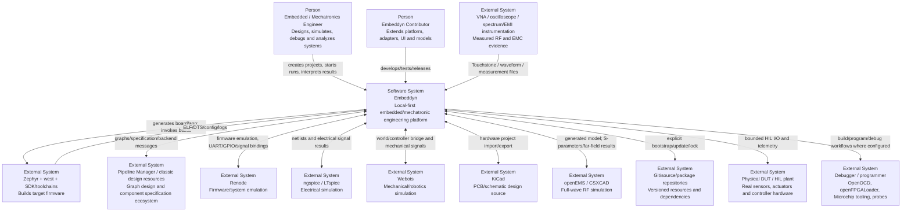

# C1 — System context

## Purpose

Embeddyn provides one local engineering environment that coordinates embedded system design/build/emulation, multi-domain simulation, observability, digital-twin evidence, and RF/EMC analysis while keeping external engineering tools behind explicit integrations.

## Context diagram

## People

### Embedded / Mechatronics Engineer

Primary user. Responsibilities include:

- defining system topology and component choices,
- generating/building firmware,
- configuring coupled simulation models,
- running/inspecting experiments,
- operating HIL under appropriate safety controls,
- importing measurement data,
- tuning RF/antenna design,
- reviewing evidence and exported artifacts.

### Embeddyn Contributor

Develops the platform itself. Needs deterministic dependencies, tests, architecture boundaries, extension contracts, and packaged documentation.

## External system relationships

### Zephyr ecosystem

Embeddyn generates board/application material and invokes `west build` with explicit argument vectors. Zephyr remains the owner of RTOS/toolchain/device-tree semantics.

### Renode

Used in both the classic embedded simulation path and mechatronics firmware adapter. Embeddyn orchestrates and binds signals; Renode owns CPU/peripheral emulation.

### SPICE tools

Electrical plant simulation is external. Embeddyn owns coupling/scheduling and adapter semantics, not the SPICE solver.

### Webots

Mechanical/robotics dynamics are external. Embeddyn owns scheduling/bindings and result integration.

### openEMS

Embeddyn can generate a validated patch model and analyze resulting Touchstone/far-field data. openEMS owns the FDTD solution.

### KiCad

Embeddyn consumes/exports integration information; KiCad remains the hardware design authority.

### Source/package repositories

Bootstrap obtains or synchronizes resources only through explicit profile/manifest/lock operations. Normal sync follows exact lock state.

### Physical DUT/HIL

Embeddyn can participate in control/telemetry loops, but real safety must include independent hardware/target mechanisms.

### RF/lab instruments

Measurement files can be analyzed in the same RF/EMC perspective as simulation results. Embeddyn does not claim a node-voltage FFT is equivalent to calibrated regulatory measurement.

## C1 quality attributes

The context drives these system qualities:

- local-first/offline-capable engineering workflows,
- deterministic dependency/workspace state,
- clear external-tool boundaries,
- traceable model/run/measurement provenance,
- safe defaults for web/HIL/process execution,
- honest separation of model/pre-compliance/formal measurement evidence.
