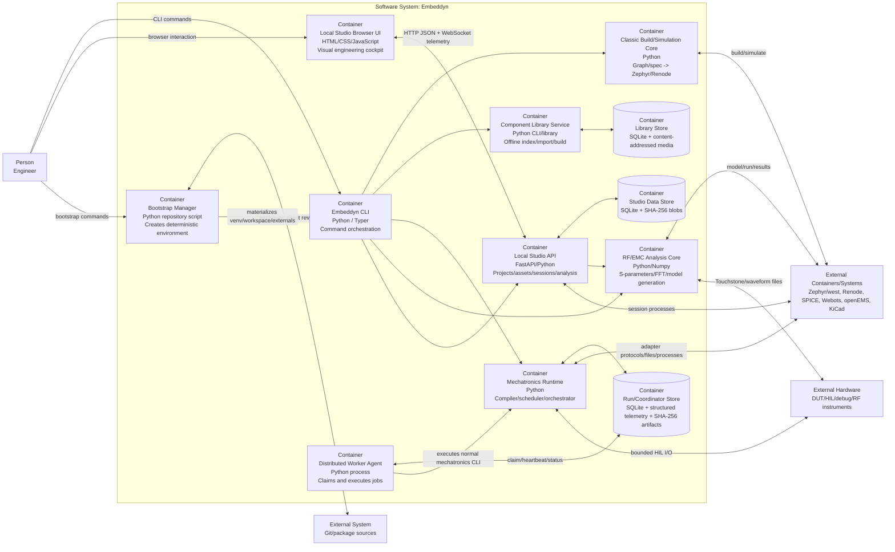

# C2 — Container view

Embeddyn is primarily a local modular monolith, but multiple runtime containers/processes and persistent stores participate in realistic workflows.

## Container diagram

## Container responsibilities

### Bootstrap Manager

**Technology:** standalone Python script + shell/PowerShell/CMD launchers.

**Owns:** profile selection, manifest validation, source synchronization/update/status, source locks/fingerprints, Python environment setup, host/workspace setup hooks.

**Does not own:** domain simulation logic or user project data.

### Embeddyn CLI

**Technology:** Typer/Python.

**Owns:** command routing and user-facing invocation of domain services. Heavy classic integrations are conditionally registered.

### Local Studio Browser UI

**Technology:** static HTML/CSS/JavaScript.

**Owns:** visual interactions, engineering cockpit presentation, linked plots/cursors/status, browser calls to API.

**Does not own:** authoritative project persistence, RF math, firmware parsing, or process launch policy.

### Local Studio API

**Technology:** FastAPI/Pydantic/Python.

**Owns:** authenticated local API, static serving, request validation, project/asset/session/telemetry endpoints, firmware/RF service orchestration.

### Studio Data Store

**Technology:** SQLite WAL + filesystem SHA-256 object store.

**Owns:** components, assets, projects, sessions, telemetry, logs, analyses and associated blobs.

### Classic Build/Simulation Core

**Technology:** Python/Jinja/Zephyr/west integration/pyrenode path.

**Owns:** specification modifications, graph resolution, generated board/app, west build orchestration, classic simulation preparation.

### Component Library Service

**Technology:** Python CLI + SQLite + content-addressed media.

**Owns:** offline source directories, importer/index, search, generated aggregate component specification.

### Mechatronics Runtime

**Technology:** Python, external adapter processes, optional PyArrow storage.

**Owns:** project validation/compilation, adapters, scheduler, coupling, runtime events/checkpoints, run storage, digital-twin/HIL/distributed coordinator functions.

### Distributed Worker Agent

**Technology:** Python subprocess manager.

**Owns:** heartbeat, claim, cancellation polling, contained output root, execution of the standard `mechatronics run` command.

It intentionally does not implement a second simulation engine.

### RF/EMC Analysis Core

**Technology:** Python/Numpy, optional scikit-rf, generated openEMS model/native wrappers.

**Owns:** Touchstone parsing/metrics, waveform FFT/masks, analytical patch seed, openEMS model generation/build/run orchestration.

## Container communication

| From | To | Mechanism |
|---|---|---|
| Browser UI | Studio API | HTTP/JSON; WebSocket for live telemetry. |
| CLI | Python domain modules | In-process calls. |
| Studio API | LocalStore | In-process SQLite/filesystem access. |
| Mechatronics | adapters | In-process or isolated process proxies; tool-specific sockets/files/processes. |
| Worker | coordinator DB | Python/SQLite access in current implementation. |
| Worker | run engine | local subprocess `python -m embeddyn mechatronics run`. |
| Bootstrap | Git/package sources | Git/Python package manager/system setup operations. |
| RF generator | openEMS | generated Python model or native XML execution. |

## Container scaling expectations

- Studio is primarily **single-user local**.
- SQLite stores are appropriate for local engineering state and modest worker coordination, not internet-scale multi-tenant service.
- Distributed worker scaling should evolve toward a dedicated coordinator service/database if many remote nodes or untrusted tenants are introduced.
- External simulator scaling is constrained by solver licensing/resources and model determinism, not just Embeddyn CPU capacity.
