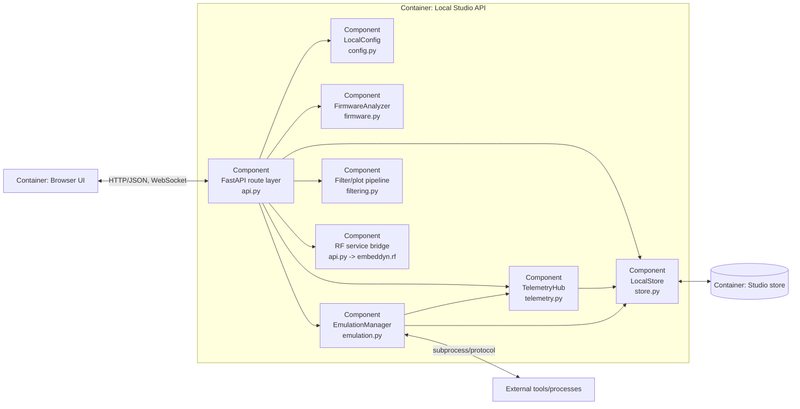
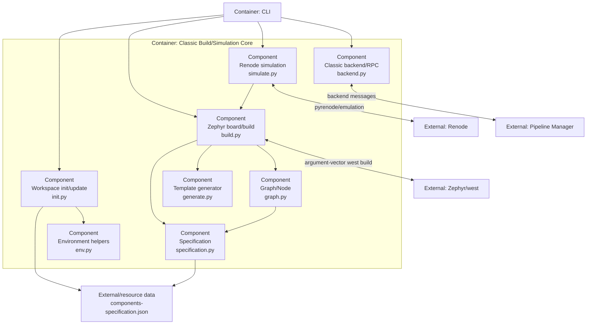
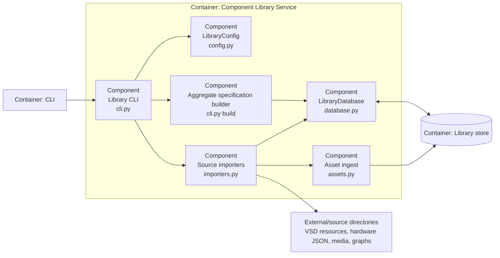
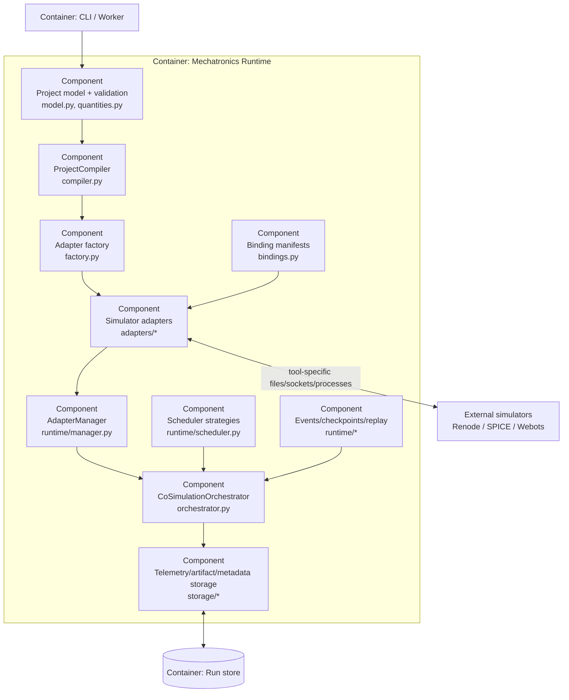
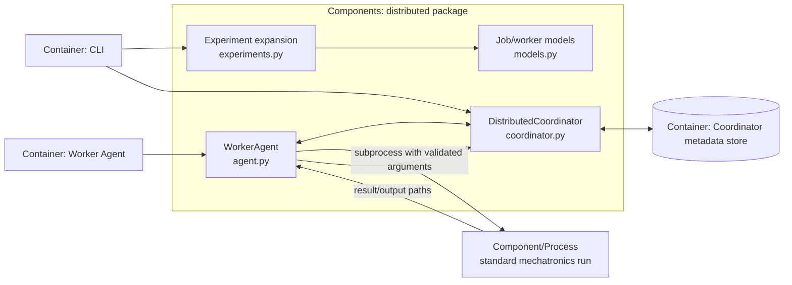
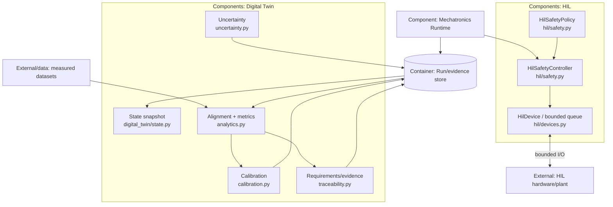
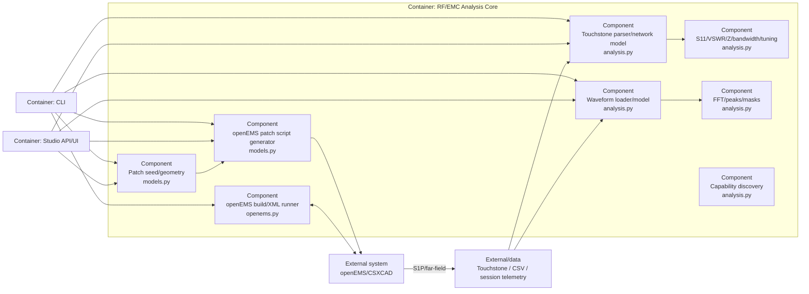
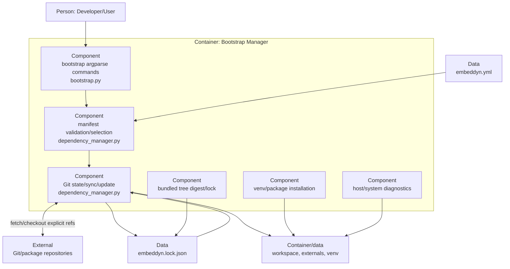

# C3 — Component views

This document zooms into the major first-party containers. It is intentionally organized by subsystem so contributors can map diagram boxes directly to modules.

## C3-A — Local Studio API

### Responsibilities

- `LocalConfig` enforces bind/token policy before server startup.
- Route request models validate JSON payloads.
- `LocalStore` owns schema/transactions/object paths.
- `FirmwareAnalyzer` is static/local and never executes the uploaded firmware.
- `EmulationManager` owns tool discovery/process sessions.
- `TelemetryHub` handles live fanout plus persistence integration.
- Filtering is restricted/structured; it is not arbitrary Python evaluation.
- RF route handling delegates calculation/model behavior to `embeddyn.rf`.

## C3-B — Classic graph/build/simulation core

### Boundary rule

`Specification`/`Graph` are declarative model components. Zephyr and Renode details should not leak into them beyond information necessary to resolve component interfaces.

## C3-C — Component library

The importer layer should remain repeatable/idempotent and network-independent. Network synchronization is a separate explicit CLI operation.

## C3-D — Mechatronics runtime

### Core runtime contract

The orchestrator operates on the common `SimulatorAdapter` contract and project signal model. External adapter behavior is expressed through capabilities/diagnostics rather than simulator-specific branches in the scheduler.

## C3-E — Distributed execution and experiments

A critical invariant is that distributed workers execute the same local run entry point and forward parameter overrides; distributed mode must not diverge into a separate simulation semantics.

## C3-F — HIL and digital-twin components

HIL safety and digital-twin evidence are adjacent but distinct: one protects physical interaction; the other interprets/validates model versus evidence.

## C3-G — RF/EMC core

The Studio cockpit is a presentation consumer of structured RF reports. The Python core remains the authoritative calculation layer.

## C3-H — Bootstrap/dependency manager

The lock is an input to `sync` and an output of explicit update/lock operations. That direction is central to reproducibility.
