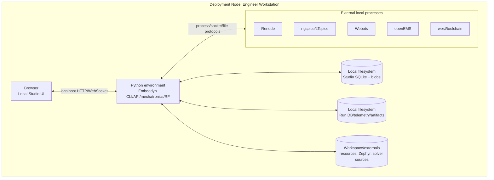
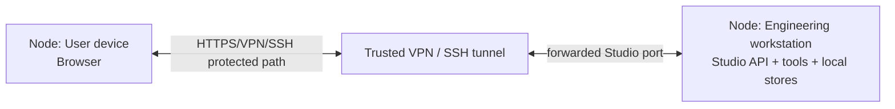
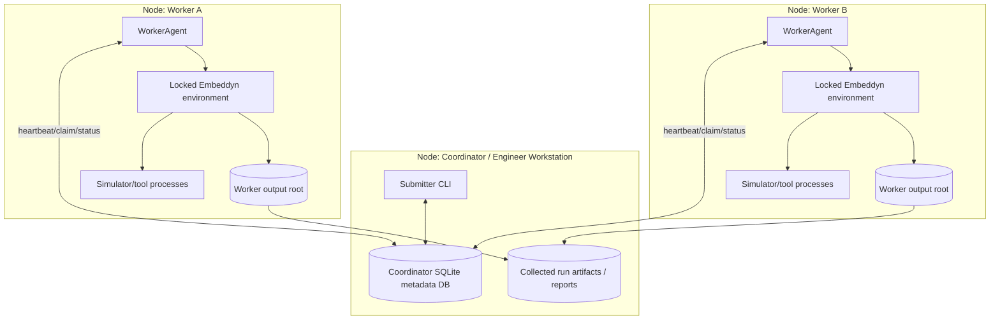
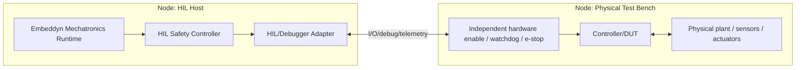
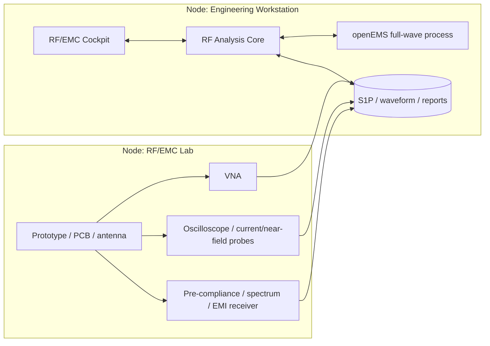

# C4 deployment view

Embeddyn is optimized for a local engineering workstation but supports distributed simulation workers and HIL/lab connections. These deployment views make the trust/performance boundaries explicit.

## DPL-1 — Standard local workstation

Recommended security posture: loopback Studio, local filesystem databases, exact dependency lock, external processes running with normal user privileges rather than administrator/root unless specifically required.

## DPL-2 — Remote browser over trusted tunnel

If binding Studio directly to a non-loopback interface, explicit remote mode and bearer token are required. A tunnel/private-network boundary is still recommended.

## DPL-3 — Distributed simulation farm

### Current deployment caveat

The coordinator is SQLite-based. A single SQLite file is not a production distributed message broker. For multiple hosts, use an arrangement that provides safe access semantics or evolve the coordinator behind a network service/database. Do not put the file on an unreliable network share and assume atomic claim/locking semantics are preserved.

### Reproducibility requirement

Workers should use the same Embeddyn commit/release, dependency lock, project inputs, and solver versions unless the experiment deliberately studies version differences.

## DPL-4 — HIL workstation

The independent hardware gate is intentionally outside the Embeddyn software node. Host software cannot be the only safety layer.

## DPL-5 — RF/EMC lab loop

Simulation and measurement enter the same analysis environment through files/telemetry, but their provenance and calibration strength must remain distinguishable.

## Deployment data locations

| Data | Recommended location |
|---|---|
| Studio SQLite/blob store | local SSD/filesystem on Studio host. |
| Mechatronics telemetry/artifacts | local/high-throughput disk; copy/archive after run. |
| External solver scratch | local fast disk; often disposable after extracting results. |
| Coordinator DB | local to coordinator; avoid casual network filesystem sharing. |
| Dependency workspace | per worker/workstation, synchronized from same lock. |
| VNA/EMC raw files | immutable project/lab evidence store with calibration/setup metadata. |

## Network ports/protocols

Ports for external simulators are configuration-dependent (for example Renode/Webots bridge sockets). Keep them loopback/private by default. Do not expose simulator control ports publicly simply because Studio remote mode is enabled.
