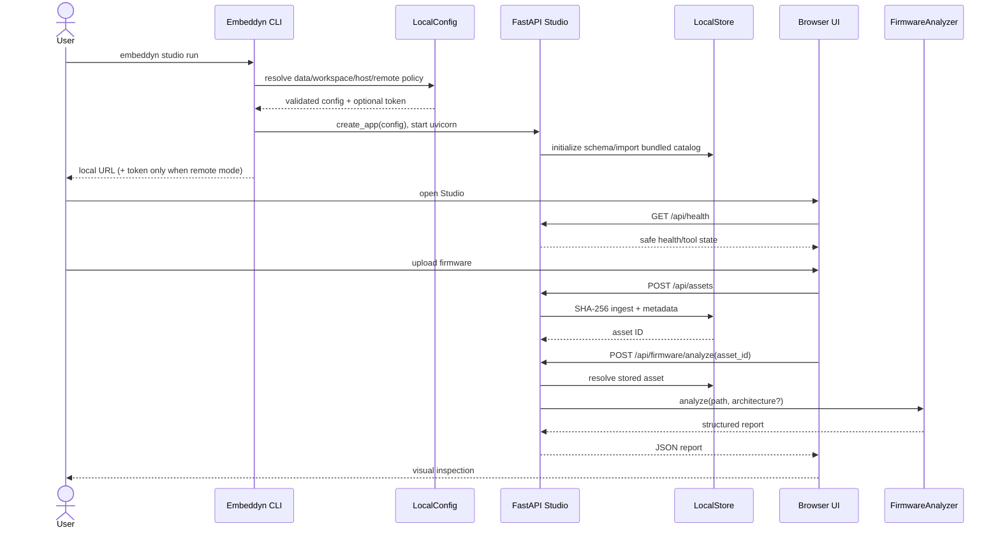
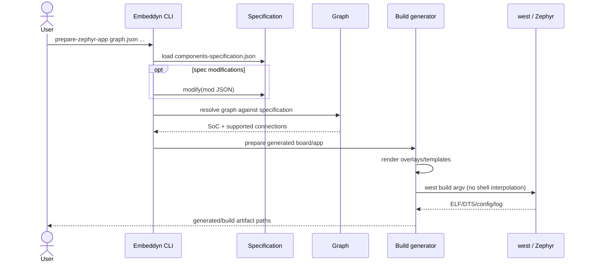
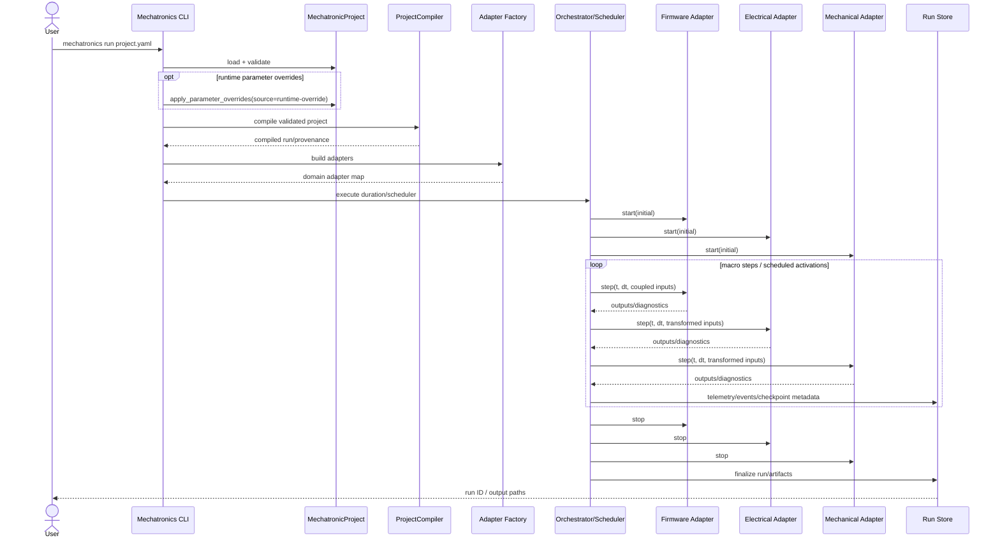
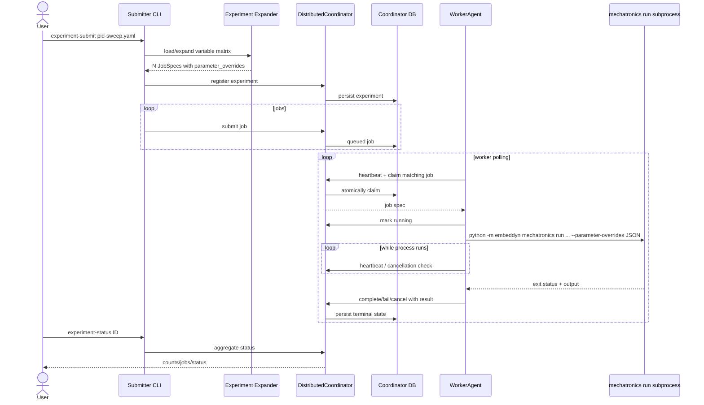
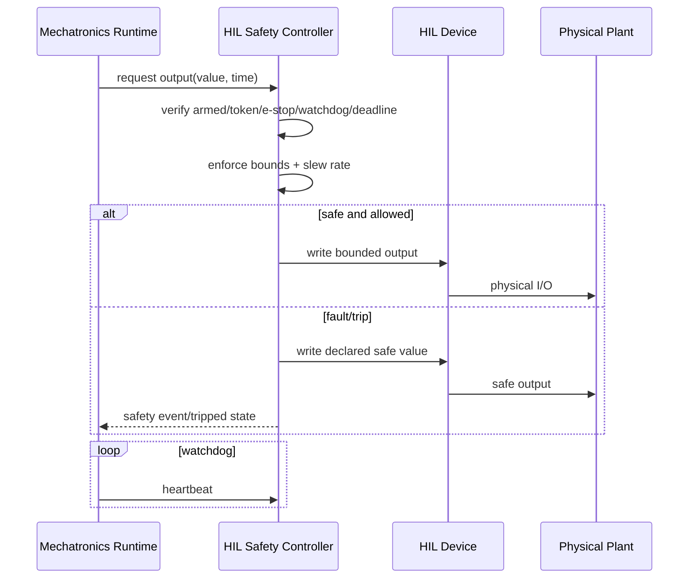
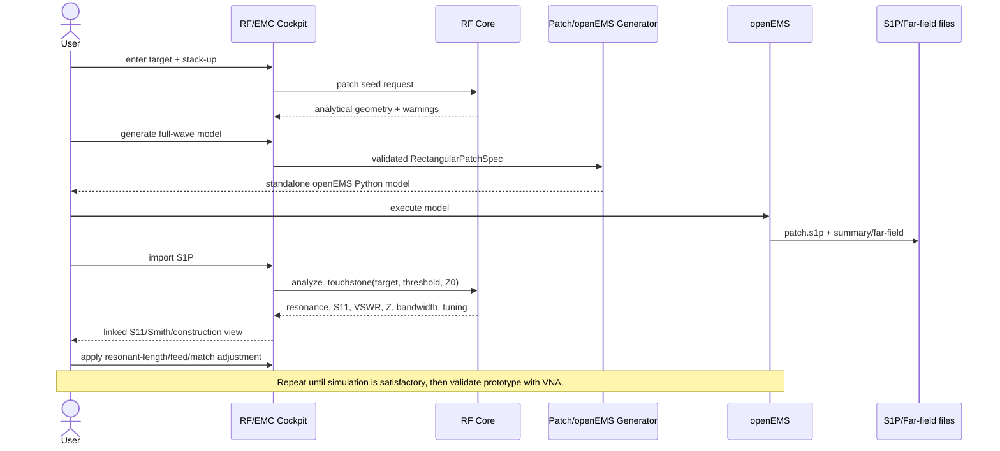
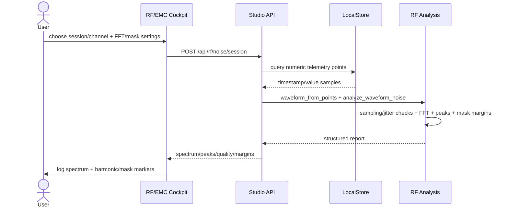
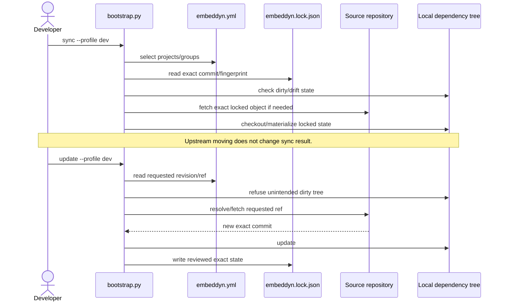

# C4 dynamic views

These sequence diagrams show important runtime interactions. They are deliberately more specific than C1/C2 but avoid method-by-method implementation detail.

## D1 — Start Local Studio and analyze firmware

## D2 — Classic graph to Zephyr build

## D3 — Coupled mechatronics run

## D4 — Distributed experiment sweep

## D5 — HIL output safety

Independent target/hardware safety is outside this software sequence and remains required.

## D6 — RF antenna tuning loop

## D7 — RF generated-noise analysis from Studio telemetry

## D8 — Dependency sync versus update

