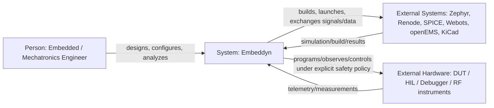

# Embeddyn C4 architecture documentation

This directory uses the C4 model to describe Embeddyn from the outside in. The diagrams are architectural communication tools, not generated UML and not a substitute for source-level API documentation.

## Levels used

| Level | Question answered | Document |
|---|---|---|
| C1 — System Context | Who uses Embeddyn and which external systems does it interact with? | [C1_CONTEXT.md](C1_CONTEXT.md) |
| C2 — Containers | What are the major runtime/deployable/process/storage units? | [C2_CONTAINERS.md](C2_CONTAINERS.md) |
| C3 — Components | Which major modules collaborate inside the important containers? | [C3_COMPONENTS.md](C3_COMPONENTS.md) |
| Dynamic views | What happens during important workflows? | [DYNAMIC_VIEWS.md](DYNAMIC_VIEWS.md) |
| Deployment | Where do those containers run in local, distributed, and HIL setups? | [DEPLOYMENT.md](DEPLOYMENT.md) |
| Decisions/boundaries | Why are important boundaries drawn this way? | [DECISIONS_AND_BOUNDARIES.md](DECISIONS_AND_BOUNDARIES.md) |

## Scope

The documented **Embeddyn System** includes first-party code in this repository:

- Python CLI/package,
- Local Studio API/static UI,
- classic graph/specification/build orchestration,
- local component library,
- mechatronics runtime/storage/distributed/HIL/digital-twin modules,
- RF/EMC analysis/model generation,
- bootstrap/dependency manager.

The following are **external systems** even when source is bundled under `externals/`:

- Zephyr/west/toolchain,
- Renode,
- ngspice/LTspice,
- Webots,
- openEMS/CSXCAD,
- KiCad,
- Pipeline Manager dependencies,
- debuggers/programmers/HIL hardware,
- VNA/EMC/lab instrumentation.

This separation is important: an external source tree being shipped in the same ZIP does not make it first-party Embeddyn architecture.

## Notation

The Markdown uses Mermaid `flowchart`/`sequenceDiagram` syntax because it is easy to review in source form. Shapes are labeled with C4 roles explicitly:

- **Person** — human actor.
- **System** — independently meaningful software/hardware system.
- **Container** — deployable/runnable process, browser app, store, or major runtime unit.
- **Component** — module/service within a container.

Arrows are labeled with protocol/data/purpose where that relationship matters.

## Architecture at a glance

## Update rule

Update C4 documentation in the same change if you introduce or remove:

- a runtime process/service,
- a persistent store,
- an external system/protocol,
- a worker/deployment role,
- a major first-party component boundary,
- a new browser/API split,
- a new physical/HIL trust boundary.

Small implementation details do not need C4 churn; architecture relationships do.
