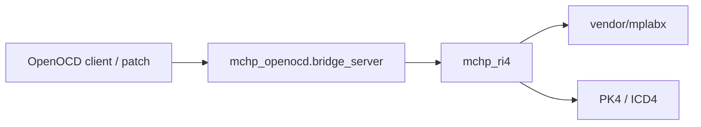

# OpenOCD Integration

This repository now includes a TCP bridge for OpenOCD-facing integrations:

## Integration Role

The OpenOCD bridge exists so OpenOCD-facing workflows can reuse the repo's clean-room RI4 family registry and session controls instead of duplicating Microchip-specific family logic inside OpenOCD itself.



- Start the bridge with `python -m mchp_openocd.bridge_server --host 127.0.0.1 --port 9123`
- Query the bridge inventory with `python -m mchp_openocd.query_bridge list-families ...` or `mchp-openocd-query list-families ...`
- Drive bridge probe/session operations with `python -m mchp_openocd.query_bridge probe-tool ...`, `start-session ...`, `session-status`, `target-status`, `end-session`, `run-script`, `enter-debug-mode`, `get-pc`, `set-pc`, `run`, `step`, `halt`, `erase-chip`, `program-hex`, `verify-hex`, program-memory access, breakpoint/watchpoint commands, and `batch`
- The bridge exposes JSON-line commands for:
  - `listFamilies`
  - `probeTool`
  - `startSession`
  - `sessionStatus`
  - `targetStatus`
  - `endSession`
  - `runScript`
  - `enterDebugMode`
  - `getPc`
  - `setPc`
  - `run`
  - `step`
  - `halt`
  - `eraseChip`
  - `programHex`
  - `verifyHex`
  - `readProgram`
  - `writeProgram`
  - `setBreakpoint`
  - `setWatchpoint`
  - `clearHardwarePoint`
  - `listHardwarePoints`

The matching OpenOCD patch lives under `openocd/patches/` and targets this bridge rather than re-implementing RI4 family logic inside OpenOCD.

Current scope:

- Family coverage mirrors the Java `MainController` family switch via `mchp_ri4.family_profiles`.
- The bridge can open RI4 hardware sessions for those families when compatible `scripts.xml` and optional `tool.xml` assets are available.
- The patch is based on `xsession/openocd` commit `cf01f0fde4caa913af479676e3c92d16a61429fc`. It was apply-checked against that tree and syntax-checked with Clang using the matching OpenOCD and pinned jimtcl headers.

## Enterprise-style Contract Summary

- Transport: newline-delimited JSON over TCP
- Ownership: the bridge owns session state once `startSession` succeeds
- Dependency: target-family hardware flows still depend on compatible script assets
- Stability goal: keep family selection and raw capability metadata centralized in `mchp_ri4.family_profiles`

`listFamilies` filtering:

- `searchPrefix`: matches the start of `family`, `programmerClass`, or `debuggerClass`.
- `capability` or `capabilities`: require one or more raw-command capability tags such as `target-vpp-control`.
- `signature` or `signatures`: require one or more raw-command signature names such as `vpp-operational-value`.
- `group` or `groups`: require one or more raw-command taxonomy groups such as `power` or `trace`.
- `capabilityMatch`, `signatureMatch`, `groupMatch`: each accepts `any` or `all`.

Example requests:

```powershell
python -m mchp_openocd.query_bridge list-families --search-prefix ProgrammerPIC32
```

This narrows the family inventory to entries whose family name or owning Java programmer/debugger class starts with `ProgrammerPIC32`.

```powershell
python -m mchp_openocd.query_bridge list-families --capability target-vpp-control --signature vpp-operational-value --capability-match all
```

This returns only families whose programmer/debugger metadata exposes both the `target-vpp-control` capability and the `vpp-operational-value` signature.

```powershell
python -m mchp_openocd.query_bridge list-families --group power --group trace --group-match all --capability target-reset-pulse --capability-match all
```

This returns only families that expose both `power` and `trace` raw-command groups and also model the `target-reset-pulse` capability.

```powershell
python -m mchp_openocd.query_bridge list-families --search-prefix PIC16 --capability target-power-status --signature power-system-status --signature runtime-data-query
```

This returns families with a matching family/class prefix that can report power status and that expose at least one of the listed status-query signatures.

Example hardware-session flow:

```powershell
python -m mchp_openocd.query_bridge probe-tool --tool pk4 --vid 0x04D8 --pid 0x9012 --key "Commands in progress"
python -m mchp_openocd.query_bridge start-session --tool pk4 --vid 0x04D8 --pid 0x9012 --processor PIC32MZ2048EFH --scripts-path C:\tools\scripts.xml --family PIC32MZ
python -m mchp_openocd.query_bridge enter-debug-mode
python -m mchp_openocd.query_bridge get-pc
python -m mchp_openocd.query_bridge set-pc --address 0x9D000000
python -m mchp_openocd.query_bridge run-script EnterDebugMode --timeout-ms 100
python -m mchp_openocd.query_bridge set-breakpoint --address 0x9D000100
python -m mchp_openocd.query_bridge set-watchpoint --address 0xA0000200 --access write --length 4
python -m mchp_openocd.query_bridge list-hardware-points
python -m mchp_openocd.query_bridge program-hex .\firmware.hex --verify
python -m mchp_openocd.query_bridge verify-hex .\firmware.hex
python -m mchp_openocd.query_bridge clear-hardware-point --slot 0
python -m mchp_openocd.query_bridge end-session
```

Those commands reuse the same long-running bridge process, so `start-session` establishes server-side session state that the later debug and programming commands can consume.

## Relationship To The Recovery Work

The current OpenOCD bridge is still focused on host-side session control and does not yet consume the Zephyr clean-room recovery-project layer directly. The recovery and observed-session work in `zephyr_pickit4_replacement/` is relevant as a future probe-firmware target, not as an already wired OpenOCD runtime dependency.

Batch request files can replay several bridge commands in one helper invocation:

```json
{
  "stopOnError": true,
  "variables": {
    "VID": "0x04D8",
    "PID": "0x9012",
    "PROC": "PIC32MZ2048EFH"
  },
  "requests": [
    {"command": "startSession", "args": {"tool": "pk4", "vid": "${VID}", "pid": "${PID}", "processor": "${PROC}", "scriptsPath": "C:\\tools\\scripts.xml", "family": "PIC32MZ"}},
    {"command": "enterDebugMode", "args": {}},
    {"command": "getPc", "args": {}},
    {"command": "endSession", "args": {}}
  ]
}
```

Run that file with `python -m mchp_openocd.query_bridge batch .\bridge-sequence.json --var PROC=PIC32MZ1024EFH`. Add `--keep-going` to ignore the file's `stopOnError` setting and continue after bridge-side failures.

## Build and run the xsession/OpenOCD target driver

Apply the included patch to the matching OpenOCD checkout:

```powershell
git clone https://github.com/xsession/openocd.git
cd openocd
git checkout cf01f0fde4caa913af479676e3c92d16a61429fc
git apply --check C:\path\to\open_microchip_tools\openocd\patches\0001-target-add-functional-Microchip-RI4-bridge.patch
git apply C:\path\to\open_microchip_tools\openocd\patches\0001-target-add-functional-Microchip-RI4-bridge.patch
```

Build OpenOCD using that repository's platform instructions. Start the Python bridge first, then launch OpenOCD with the probe and script-pack values required by the target config:

```powershell
# Terminal 1
python -m mchp_openocd.bridge_server --host 127.0.0.1 --port 9123

# Terminal 2: PIC18 example
openocd `
  -c "set RI4_VID 0x04D8" `
  -c "set RI4_PID 0x9012" `
  -c "set RI4_PROCESSOR PIC18F47K42" `
  -c "set RI4_SCRIPTS C:/tools/scripts.xml" `
  -f target/pic18-ri4.cfg
```

OpenOCD's normal `halt`, `resume`, `step`, program-memory access, `bp`, and `wp` paths now call the RI4 bridge. Programming is also available from the OpenOCD command console:

```text
mchp_ri4 erase
mchp_ri4 program C:/firmware/app.hex verify
mchp_ri4 verify C:/firmware/app.hex
```

Hardware execute breakpoints and data watchpoints share the probe's comparator slots. The bridge allocates the lowest free slot and reports resource exhaustion back to OpenOCD.
